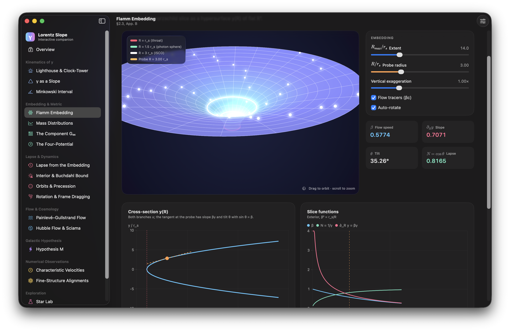
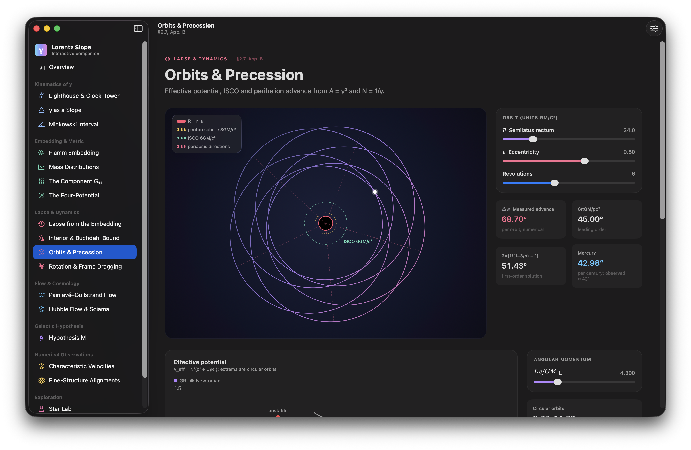
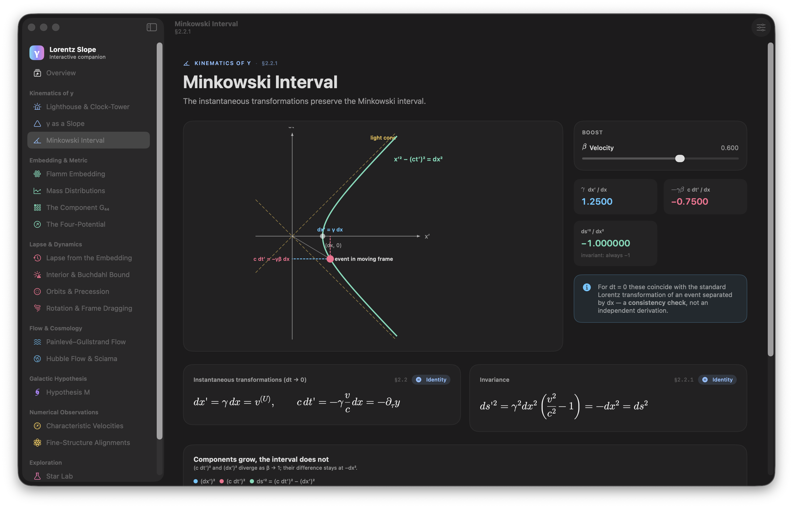

# Lorentz Slope Visualizer

An interactive macOS companion to the paper **"The Lorentz Factor as the Slope of an Additional Spatial Coordinate: Embedding, Painlevé–Gullstrand Flow, and the Issue of Simultaneity"**. You can read the full paper on Zenodo: [zenodo.org/records/24451649](https://zenodo.org/records/24487055).

Don't forget to whitelist the application in your settings. I have an Apple certificate but it wasn't worth waiting to get notarized for a simple demo application like this.

The paper reads the Lorentz factor as the slope of an additional, non-compactified spatial coordinate _y_:

$$\gamma = \sqrt{1 + (\partial_x y)^2}$$

Every page in the app is live. Drag a slider and every plot, 3D surface and readout updates, so students can see how each function in the model responds when one variable changes.

## Screenshots

|                                                                                                                                      |                                                                                                         |
| ------------------------------------------------------------------------------------------------------------------------------------ | ------------------------------------------------------------------------------------------------------- |
|                                                                           |                                              |
| **Orbits & Precession:** Schwarzschild orbits integrated live, with the ISCO, the photon sphere and the measured perihelion advance. | **Minkowski Interval:** the instantaneous transformations move the event along the invariant hyperbola. |

## What's inside

| Section                | Pages                                                                                                  |
| ---------------------- | ------------------------------------------------------------------------------------------------------ |
| Overview               | 3D Flamm embedding, the four core relations, a map of the paper                                        |
| Kinematics of _y_      | Lighthouse & Clock-Tower · γ as a Slope · Minkowski Interval                                           |
| Embedding & Metric     | Flamm Embedding · Mass Distributions · The Component G₄₄ · The Four-Potential                          |
| Lapse & Dynamics       | Lapse from the Embedding · Interior & Buchdahl Bound · Orbits & Precession · Rotation & Frame Dragging |
| Flow & Cosmology       | Painlevé–Gullstrand river flow · Hubble Flow & the Sciama identity                                     |
| Galactic Hypothesis    | Hypothesis M against the Milky Way rotation curve, with a live g₀ fit                                  |
| Numerical Observations | Characteristic Velocities · Fine-Structure Alignments                                                  |
| Exploration            | Star Lab · Rapidity Composition · Dictionary & Status                                                  |

Every equation carries a badge that follows the paper's own separation of claims: _identity_, _derived here_, _equivalent to GR_, _imported from GR_, _assumption_, _hypothesis_, _numerical alignment_ or _exploration_. The universal constants (c, G, H₀, κ′, τ̂) can be changed from the toolbar inspector and update every page.

## Building

1. You need macOS 26 and Xcode 26.
2. Open `AlphaOmegaGravityVisualizer.xcodeproj` and run the `AlphaOmegaGravityVisualizer` scheme. Swift Package Manager resolves the dependencies; LaTeX is rendered with [SwiftMath](https://github.com/mgriebling/SwiftMath).
3. Press `⌘U` to run `PhysicsModelTests`, which check the model against values quoted in the paper.

## Data

- Milky Way circular velocities: Eilers et al. (2019).
- CMB dipole: Planck 2018.
- γ_PPN: Cassini (Bertotti et al. 2003).
- Frame dragging: Gravity Probe B (Everitt et al. 2011).
- Radial acceleration relation: McGaugh et al. (2016).

The Galactic baryonic model is approximate. It is rescaled to 4.44 × 10¹⁰ M☉ inside 8.12 kpc, as in the paper.

## License

MIT. See `license.md`.
