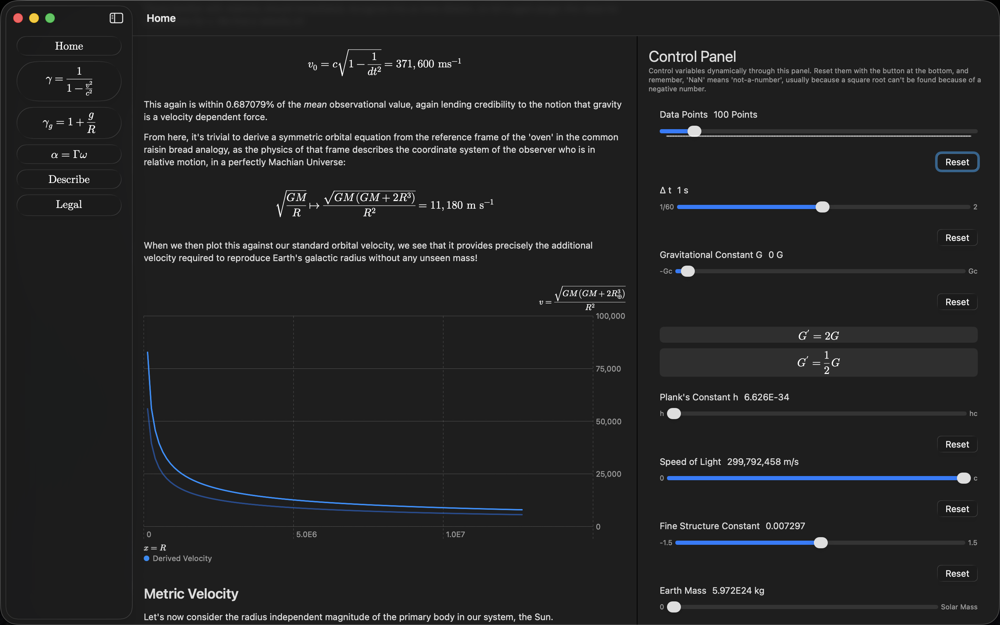

# Lorentz Slope Visualizer

An interactive macOS companion to the manuscript **"The Lorentz Factor as the Slope of an Additional Spatial Coordinate: Embedding, Painlevé–Gullstrand Flow, and the Issue of Simultaneity"** (Andrew Mueller).

Every page is live. Drag a slider and every plot, 3D surface and readout updates. The app is meant for undergraduate and graduate students who want to see how each function in the model responds when a variable changes.

The central relation is

$$\gamma = \sqrt{1 + (\partial_x y)^2},$$

the Lorentz factor read as the slope of an additional, non-compactified spatial coordinate *y*. Where it can be checked, the construction is equivalent to general relativity. One explicit hypothesis, horizon-limited Machian inertia, goes beyond it.

## Pages

| Section | Pages |
|---|---|
| Overview | Hero 3D Flamm embedding, the four core relations, map of the paper |
| Kinematics of *y* | Lighthouse & Clock-Tower · γ as a Slope · Minkowski Interval |
| Embedding & Metric | Flamm Embedding (3D) · Mass Distributions (point mass, uniform star, critical density) · The Component G₄₄ (Cassini, Brans–Dicke, scalar charge) · The Four-Potential |
| Lapse & Dynamics | Lapse from the Embedding (numerical integration vs closed form) · Interior & Buchdahl Bound · Orbits & Precession · Rotation & Frame Dragging (Gravity Probe B) |
| Flow & Cosmology | Painlevé–Gullstrand river flow (animated) · Hubble Flow & the Sciama identity |
| Galactic Hypothesis | Hypothesis M against the Milky Way rotation curve, with a live g₀ fit |
| Numerical Observations | Characteristic velocities (CMB dipole, dependence on L_τ) · Fine-structure alignments |
| Exploration | Star Lab (non-uniform stars and their compactness limit) · Rapidity Composition · Dictionary & Status |

Every equation carries a status badge that follows the paper's own separation of claims: *identity*, *derived here*, *equivalent to GR*, *imported from GR*, *assumption*, *hypothesis*, *numerical alignment*, and *exploration*. Universal constants (c, G, H₀, κ′, τ̂) can be changed from the inspector (toolbar ▸ Constants) and propagate to every page.

## Building

- Requires macOS 26 and Xcode 26 (the UI uses Liquid Glass and current Swift Charts).
- Open `AlphaOmegaGravityVisualizer.xcodeproj` and run the `AlphaOmegaGravityVisualizer` scheme.
- Dependencies are resolved by Swift Package Manager. LaTeX is rendered with [SwiftMath](https://github.com/mgriebling/SwiftMath).
- `⌘U` runs `PhysicsModelTests`. These check the model against values quoted in the manuscript: v_kinematic = 371,580 m/s, the Buchdahl limit 8/9, the Lense–Thirring average for the Gravity Probe B orbit, Mercury's 43″ per century, and others.

The previous α ω version of the interface is kept in `legacy_v1/` for reference. It is not part of the build.

## Data

Milky Way circular velocities: Eilers et al. (2019). CMB dipole: Planck 2018. γ_PPN: Cassini (Bertotti et al. 2003). Frame dragging: Gravity Probe B (Everitt et al. 2011). Radial acceleration relation: McGaugh et al. (2016). The Galactic baryonic model is approximate and is rescaled to 4.44 × 10¹⁰ M☉ inside 8.12 kpc, as in the paper. Eilers per-point uncertainties are not bundled, so χ² uses a uniform fractional error.

## License

MIT. See `license.md`.
